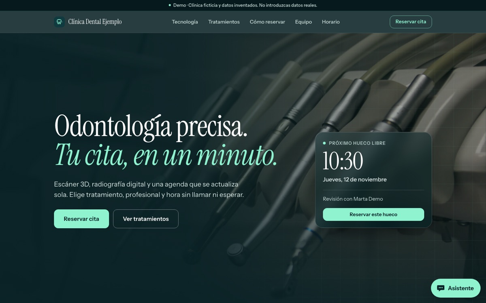
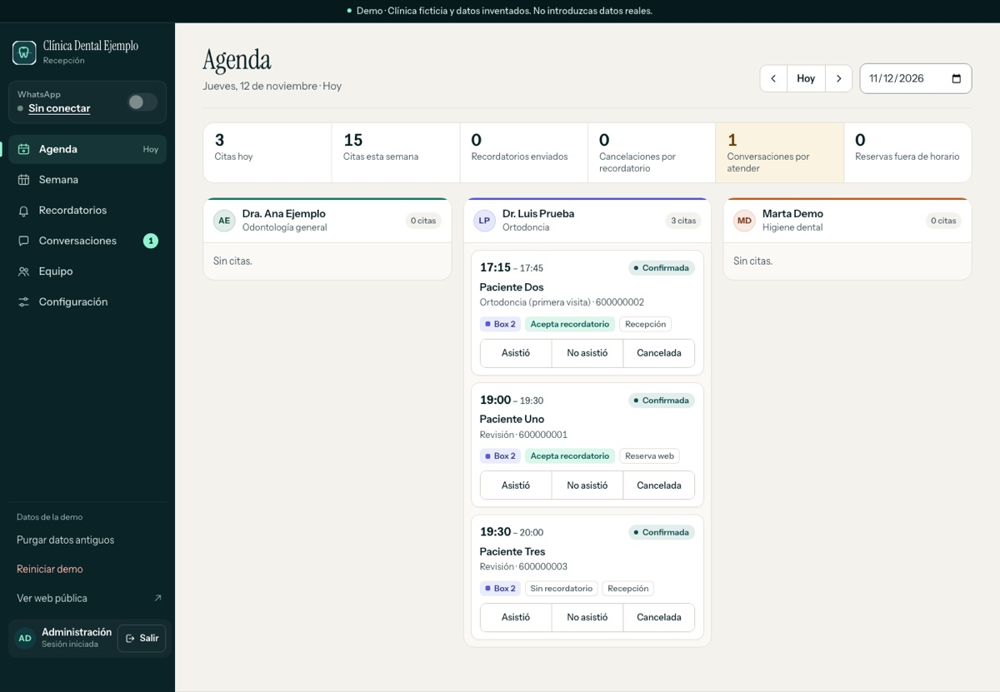
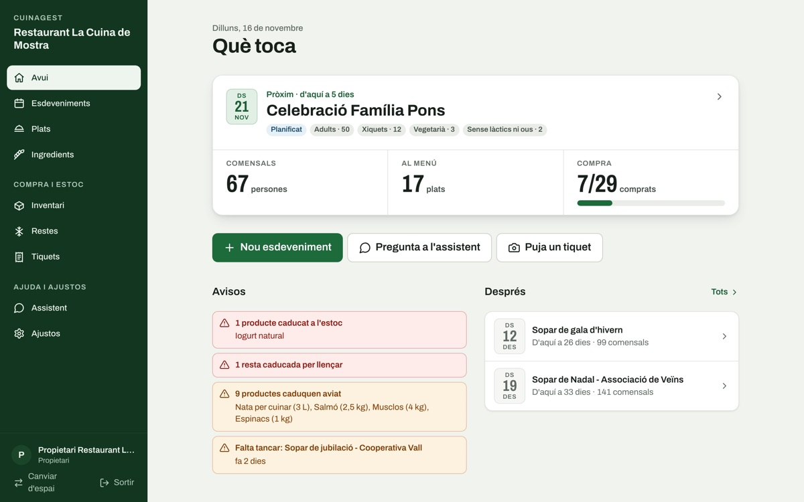
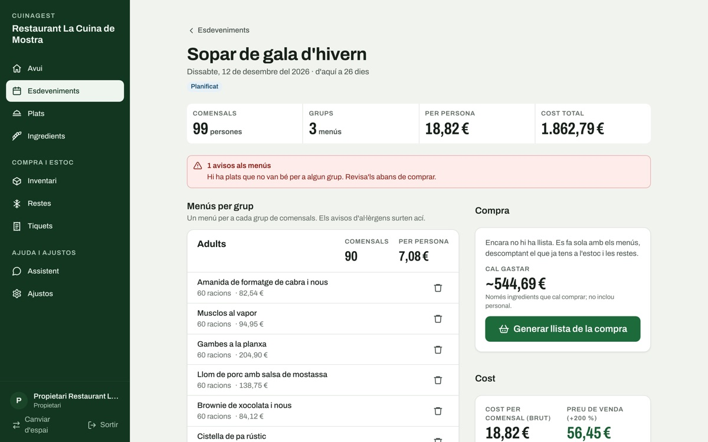
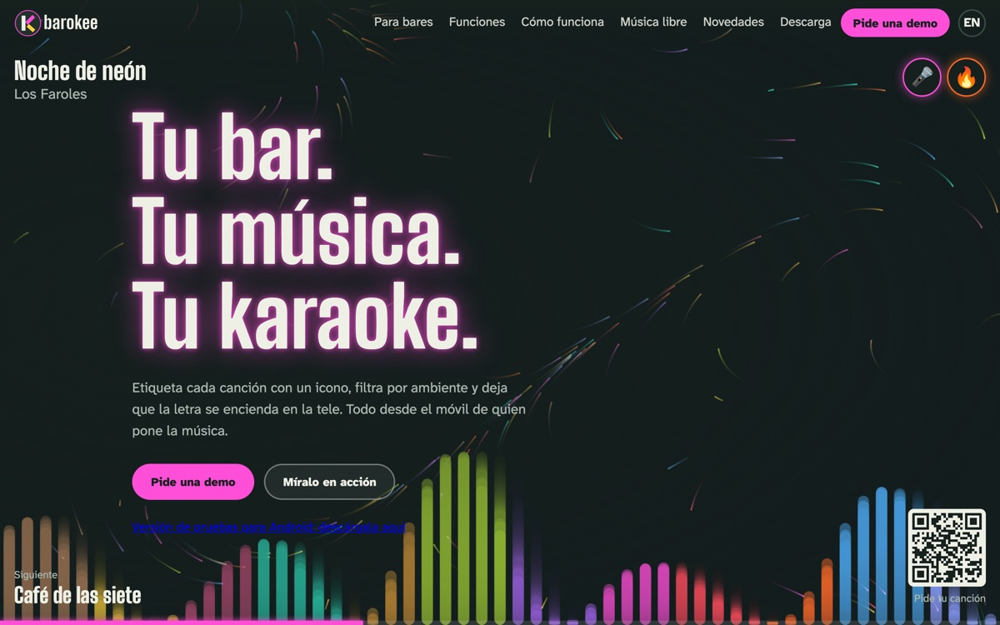
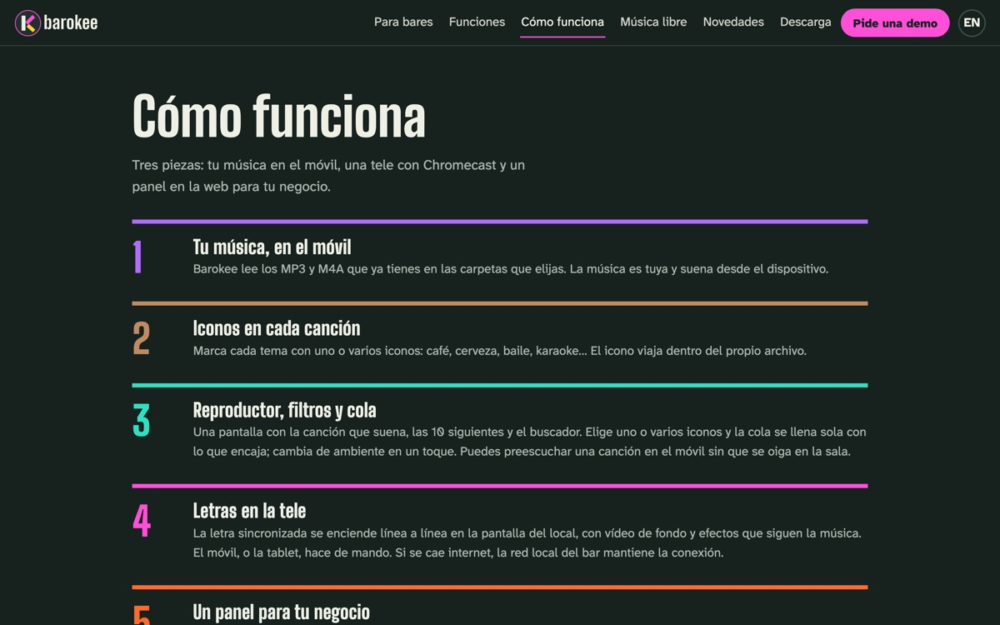

# Pere Mataix Sempere

**Web, automation and AI developer · Muro de Alcoy (Alicante, Spain)**

[Español](README.md) · English

📫 pere.mataix@gmail.com · 📱 +34 647 945 468 · [LinkedIn](https://www.linkedin.com/in/pere-mataix)

Telecommunications engineer with 12 years in PHP (Symfony, MySQL, JavaScript) and 9 in .NET (ASP.NET Core, SQL Server, DevOps). Freelance since November 2026, building online booking sites, automations and AI assistants for small businesses. Always custom-built and business-first: what the problem is, what to automate and what is better left alone.

## What I can do for your business

| If this happens to you… | …I can build this |
|---|---|
| Bookings arrive by phone and WhatsApp and slots get lost | Online booking connected to your calendar (Google, Microsoft or built-in) and consent-based reminders |
| You answer the same questions over and over | A website or WhatsApp assistant that answers with your information and hands over what it doesn't know |
| You copy data by hand between email, spreadsheets and your software | Automations and API integrations between the tools you already use |
| Your website brings no clients, or you have none | A fast, clear website linked to your Google Business profile |
| Your data is scattered and you don't know what works | A tidy database and dashboards with what you actually need to see |

📄 **Leaflet for local shops** (Valencian and Spanish): [view online](https://pemasem.github.io/pemasem/triptic/) · [download PDF](triptic/triptic-pere-mataix.pdf)

## How I work

1. **We talk about your business**, not technology. You tell me what eats your time.
2. **I propose the smallest thing that solves it**, with a written quote. If something isn't worth automating, I'll say so.
3. **I build it and you test it with sample data** before anything real is touched.
4. **We go live** and I show you how to use it.

**Got something in mind?** Email pere.mataix@gmail.com or message me on [LinkedIn](https://www.linkedin.com/in/pere-mataix) for a no-obligation quote.

---

## Projects

### Dental clinic booking demo · [live demo](https://demo-clinica-pied.vercel.app)

Booking site and front desk for a clinic, with fictional data. Patients book in 4 steps and get a cancellation code. An AI assistant (Claude, GPT or Gemini, chosen in the admin panel) answers on the website and on WhatsApp, says it is automated and hands anything medical to the front desk. Front-desk panel with daily agenda per practitioner, weekly calendar and conversations. Configurable team: shifts, services per doctor, treatment rooms and automatic practitioner assignment. Built-in calendar or Google, Microsoft or any API.

`Python` `FastAPI` `PostgreSQL (Neon)` `Vercel` `WhatsApp Business API` `LLM tool use`

  
  

### CuinaGest · [live demo](https://cuinagest.vercel.app)

Kitchen management for festival associations and banquet restaurants, in Valencian and Spanish. Events with diner groups (adults, children, vegetarian, allergies) and a menu per group with cost per person; allergen warnings for human review; shopping list per shop in route order, minus existing stock; recipe costing, stock with expiry dates and leftovers reuse; chat assistant (web and WhatsApp) that confirms before changing anything.

`Next.js` `React` `TypeScript` `Prisma` `PostgreSQL (Neon)` `Vercel`

  
  

### Barokee · [barokee.com](https://barokee.com)

Karaoke for bars: whoever plays the music runs it from a phone and the venue's TV shows synced lyrics. Icon tags to filter the queue by mood, song requests and messages by QR with moderation, scrolling announcements, several screens and Bluetooth speaker, music plays from the device without depending on the internet, and a web admin panel.

`Flutter` `Dart` `TypeScript` `Google Cast` `React`

  
  

> These projects' repositories are private. Demos use made-up data.

---

## Experience

- **Nov 2026 – present** · Freelance web, automation and AI developer.
- **2022 – 2026** · Cooper Advertising.
- 12+ years with PHP (Symfony, MySQL, JavaScript) and 9 with .NET (ASP.NET Core, DevOps) and SQL Server (T-SQL).

## Technologies

- **Now:** Python (FastAPI), TypeScript (Next.js, React), Flutter/Dart, PostgreSQL, SQLite, Vercel, LLM APIs (Claude, GPT, Gemini), WhatsApp Business API.
- **Long experience:** PHP (Symfony), .NET (ASP.NET Core, WebForms, WinForms), SQL Server (T-SQL), MySQL, REST and SOAP web services.
- **Other:** Git, Redis, MongoDB, Angular, jQuery.
- **Practices:** OOP and SOLID, design patterns, layered architectures, automated tests, usability.

## Education

- **1998 – 2003** · Telecommunications Engineering, Telematics.
- **2003** · Technical assistant in industrial and interior design (Servef).
- C.A.P. teaching certificate.

## Languages

Spanish and Catalan (native). English (conversational).
