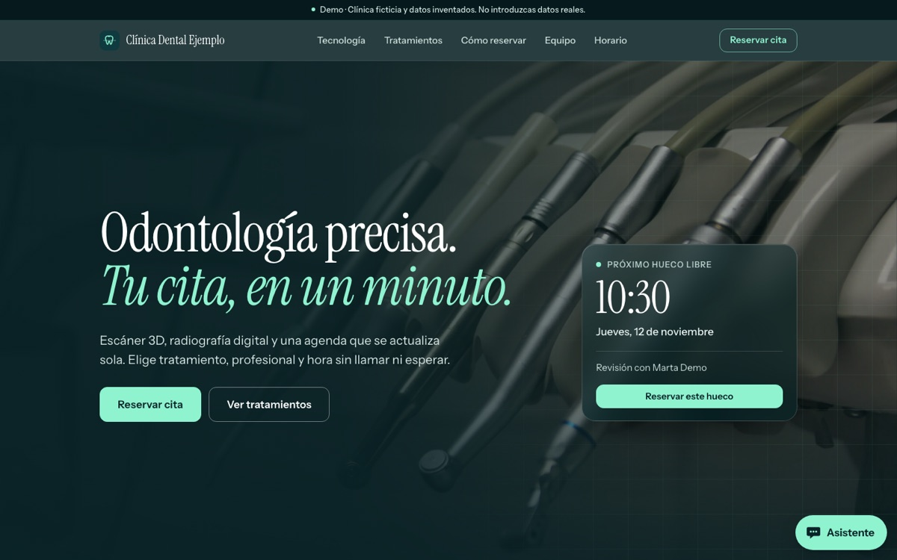
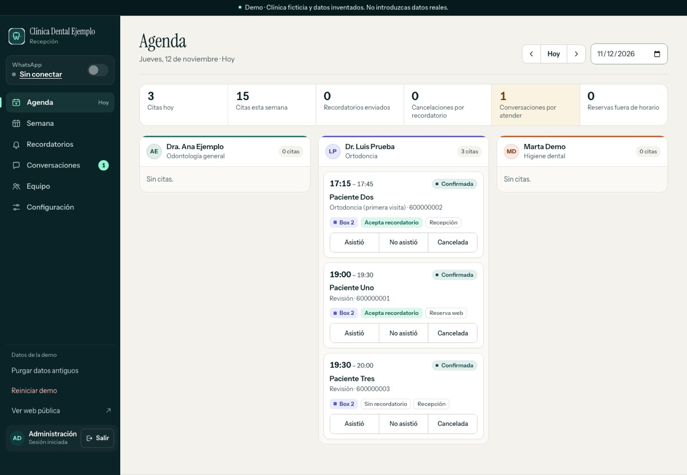
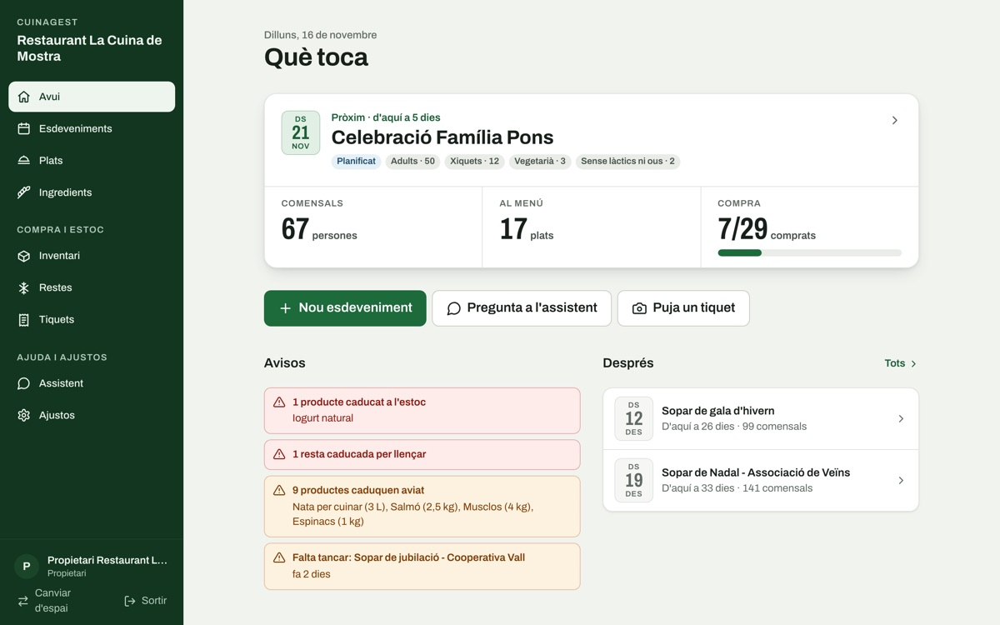
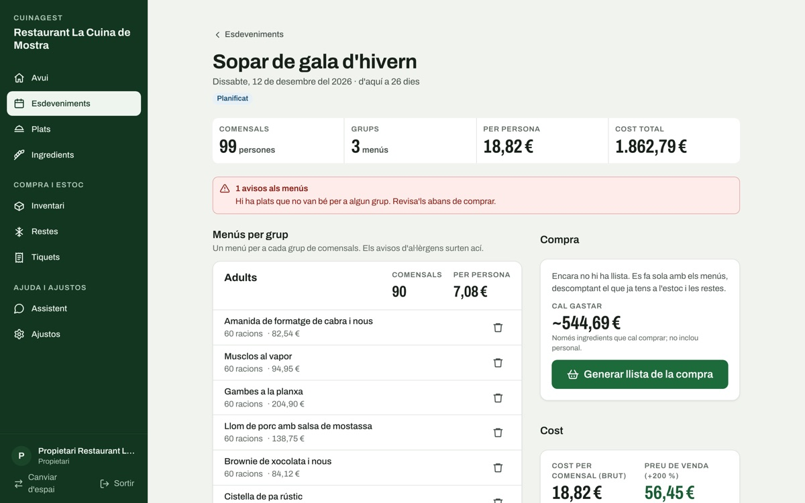
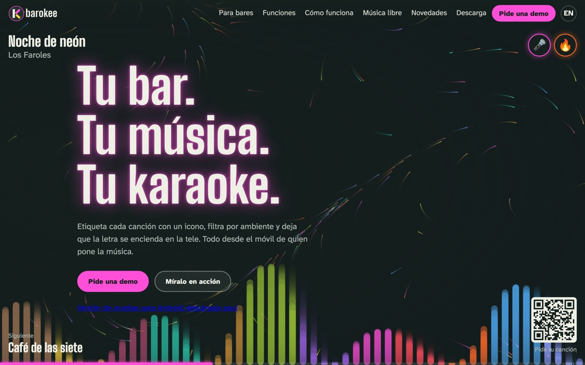
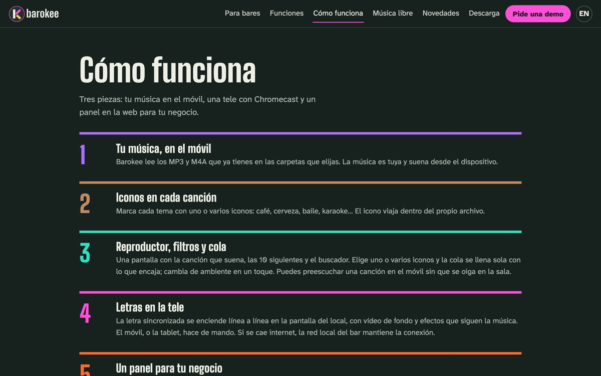

# Pere Mataix Sempere

**Desarrollador web y de automatizaciones con IA · Muro de Alcoy (Alicante)**

Español · [English](README.en.md)

📫 pere.mataix@gmail.com · 📱 +34 647 945 468 · [LinkedIn](https://www.linkedin.com/in/pemasem) · [Página profesional](https://www.linkedin.com/company/pere-mataix-desarrollo)

Ingeniero de Telecomunicaciones, con 12 años en PHP (Symfony, MySQL, JavaScript) y 9 en .NET (ASP.NET Core, SQL Server, DevOps). Desde noviembre de 2026 trabajo como autónomo para pymes: webs con reservas online, automatizaciones y asistentes con IA. Siempre a medida y con el negocio delante: qué problema hay, qué se automatiza y qué es mejor dejar como está.

## Qué puedo hacer por tu negocio

| Si te pasa esto… | …puedo hacer esto |
|---|---|
| Las citas llegan por teléfono y WhatsApp y se pierden huecos | Reserva online conectada a tu agenda (Google, Microsoft o la propia) y recordatorios con consentimiento |
| Contestas una y otra vez las mismas preguntas | Un asistente en la web o en WhatsApp que responde con tu información y te pasa lo que no sabe |
| Pasas datos a mano entre el correo, hojas de cálculo y el programa de gestión | Automatizaciones e integraciones por API entre las herramientas que ya usas |
| Tu web no te trae clientes o no tienes web | Una web rápida y clara, con tu ficha de Google bien enlazada |
| Tus datos están repartidos y no sabes qué funciona | Una base de datos ordenada y paneles con lo que de verdad necesitas mirar |

📄 **Tríptico para comercios** (valenciano y castellano): [ver online](https://pemasem.github.io/pemasem/triptic/) · [descargar PDF](triptic/triptic-pere-mataix.pdf) · [¿qué te ayudaría? (formulario)](https://pemasem.github.io/pemasem/contacte/)

## Cómo trabajo

1. **Hablamos de tu negocio**, no de tecnología. Me cuentas qué te quita tiempo.
2. **Te propongo lo mínimo que lo resuelve**, con presupuesto por escrito. Si algo no merece la pena automatizarlo, te lo digo.
3. **Lo construyo y lo pruebas con datos de ejemplo** antes de tocar nada real.
4. **Lo ponemos en marcha** y te enseño a usarlo.

Los datos de tus clientes se tratan con cuidado: cifrado, mínimos necesarios y servidores en la UE cuando es posible.

**¿Tienes algo en mente?** Escríbeme a pere.mataix@gmail.com o por [LinkedIn](https://www.linkedin.com/in/pemasem) y te preparo un presupuesto sin compromiso.

---

## Proyectos

### Demo de reservas para clínica dental · [ver demo](https://demo-clinica-pied.vercel.app)

Web de reservas y recepción de una clínica, con datos ficticios.

- El paciente reserva en 4 pasos: servicio, profesional o «sin preferencia», hora libre real y sus datos. Recibe un código para cancelar.
- Un asistente con IA (Claude, GPT o Gemini, se elige en el panel) atiende en la web y por WhatsApp. Dice que es automático y pasa a recepción cualquier cosa médica.
- En WhatsApp, si recepción contesta desde el móvil, el bot se calla. Hay un interruptor para pausarlo.
- Panel de recepción con la agenda del día por profesional, la semana en calendario y las conversaciones.
- Equipo configurable: horarios por tramos, servicios de cada doctor, boxes y asignación automática del profesional.
- Calendario interno o conectado a Google, Microsoft o cualquier API.

`Python` `FastAPI` `PostgreSQL (Neon)` `Vercel` `WhatsApp (YCloud, Meta, Twilio)` `LLM con herramientas`

  
  

### CuinaGest · [ver demo](https://cuinagest.vercel.app)

Gestión de cocina para filaes festeras y restaurantes de banquetes, en valenciano y castellano.

- Pantalla «Què toca»: el próximo evento, los comensales, la compra pendiente y los avisos del día.
- Eventos con grupos de comensales (adultos, niños, vegetarianos, alérgicos) y un menú para cada grupo, con coste por persona y precio de venta.
- Avisos de alérgenos cruzando ingredientes y restricciones, siempre para revisión humana.
- Lista de la compra por tienda, en el orden de la ruta y descontando lo que ya hay.
- Escandallo de cada plato, inventario con caducidades y restos que se reaprovechan.
- Asistente por chat (web y WhatsApp) que confirma antes de cambiar nada.

`Next.js` `React` `TypeScript` `Prisma` `PostgreSQL (Neon)` `Vercel`

  
  

### Barokee · [barokee.com](https://barokee.com)

Karaoke para bares: quien pone la música lo lleva desde el móvil y la tele del local muestra la letra sincronizada.

- Etiquetas con iconos para filtrar la cola por ambiente.
- Los clientes piden canciones y mandan mensajes por QR, con moderación.
- Marquesina con avisos, varias pantallas y altavoz Bluetooth.
- La música suena desde el dispositivo, sin depender de internet.
- Panel web para dispositivos y biblioteca.

`Flutter` `Dart` `TypeScript` `Google Cast` `React`

  
  

> Los repositorios de estos proyectos son privados. Las demos usan datos inventados.

---

## Experiencia

- **Nov. 2026 – actualidad** · Desarrollador web y de automatizaciones con IA, autónomo.
- **2022 – 2026** · Cooper Advertising.
- Más de 12 años con PHP (Symfony, MySQL, JavaScript) y 9 con .NET (ASP.NET Core, DevOps) y SQL Server (T-SQL).

## Tecnologías

- **Ahora:** Python (FastAPI), TypeScript (Next.js, React), Flutter/Dart, PostgreSQL, SQLite, Vercel, APIs de LLM (Claude, GPT, Gemini), WhatsApp Business API.
- **Experiencia larga:** PHP (Symfony), .NET (ASP.NET Core, WebForms, WinForms), SQL Server (T-SQL), MySQL, servicios web REST y SOAP.
- **Otros:** Git, Redis, MongoDB, Angular, jQuery.
- **Forma de trabajar:** orientación a objetos y SOLID, patrones de diseño, arquitecturas por capas, tests automáticos, atención a la usabilidad.

## Formación

- **1998 – 2003** · Ingeniería de Telecomunicaciones, especialidad Telemática.
- **2003** · Técnico auxiliar en diseño industrial e interiorismo (Servef).
- C.A.P. (capacitación para la docencia).

## Idiomas

Español y catalán nativos. Inglés de conversación.
